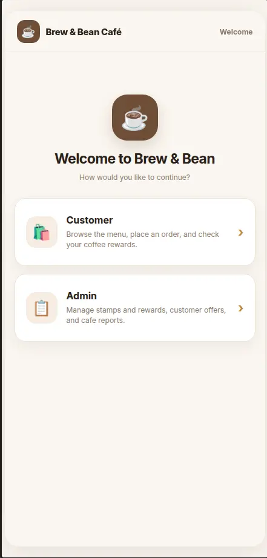
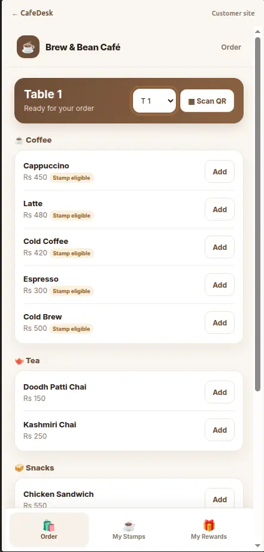
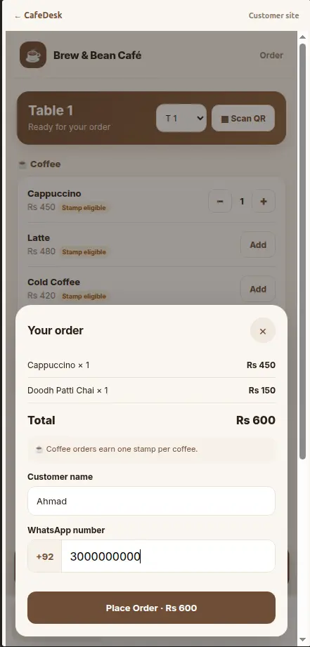

# CafeDesk Demo

> A self-contained, mobile-first cafe ordering and loyalty dashboard for Brew & Bean Café.

CafeDesk is a browser-based product demo that models two connected experiences:

- **Customer portal** — browse the menu, place a table order, view coffee stamps, redeem rewards, and leave a review.
- **Admin portal** — manage customer stamps, redeem rewards, create comeback offers, review campaign activity, and monitor cafe performance.

The demo is intentionally lightweight: it uses semantic HTML, CSS, and vanilla JavaScript with no build step, backend, package installation, or external data service.

## Demo

Open [`index.html`](./index.html) to choose a portal:

- [`client.html`](./client.html) — customer-facing experience
- [`admin.html`](./admin.html) — staff and owner experience

### Live demo

Visit the deployed application at **[cafedesk-swart.vercel.app](https://cafedesk-swart.vercel.app/)**.

For the best experience, serve the folder with any static file server and open the resulting URL in a modern browser. Opening the HTML files directly also works in most browsers.

```bash
# Example with Python
python3 -m http.server 8000
```

Then visit <http://localhost:8000>.

## Screenshots

### Customer experience

| Home | Menu | Checkout |
| --- | --- | --- |
| [](./assets/homescreen.webp) | [](./assets/orderscreen.webp) | [](./assets/checkoutscreen.webp) |

| Confirm order | My stamps | Review |
| --- | --- | --- |
| [](./assets/conform%20order%20screen.webp) | [](./assets/my%20stamp%20screen.webp) | [](./assets/review%20screen.webp) |

### Admin experience

| Stamps | Rewards | Come Back |
| --- | --- | --- |
| [](./assets/admin%20stamp%20screen.webp) | [](./assets/Admin%20rewards%20screen.webp) | [](./assets/Admin%20comeback%20screen.webp) |

| Dashboard | Dashboard detail | Come Back detail |
| --- | --- | --- |
| [](./assets/Admin%20dashboard%20screen.webp) | [](./assets/Admin%20dashboard%20screen2.webp) | [](./assets/Admin%20comeback%20screen%202.webp) |

## Features

### Customer portal

- Table selection and demo QR scan flow
- Menu browsing across coffee, tea, snacks, and desserts
- Cart sheet with quantity controls and order confirmation
- Customer lookup with phone validation
- Visit and coffee-stamp progress
- Reward progress and redemption
- Review prompt with editable Google Review destination

### Admin portal

- Customer search and stamp awarding
- Reward redemption tracking
- Lapsed-customer comeback offers
- WhatsApp outreach link generation
- Campaign history and automation toggles
- Dashboard KPIs, seven-day order trends, top items, and review metrics
- Reset action for restoring the seeded demo state

## How the demo works

The application is a shared single-page experience loaded by the three entry points. The portal query parameter controls which screens and navigation items are visible:

```text
index.html                 Portal selector
index.html?portal=customer Customer experience
index.html?portal=admin    Admin experience
```

`client.html` and `admin.html` provide focused entry points around those portal views. Both portals read and update the same browser `localStorage` state, so actions in one portal are reflected in the other when they use the same browser profile.

The initial demo state includes:

- 12 sample customers
- 12 menu items
- 30 orders distributed across the previous 14 days
- 3 past campaigns
- Representative stamps, rewards, and review data

## Project structure

| File | Purpose |
| --- | --- |
| [`index.html`](./index.html) | Complete CafeDesk application, styles, seeded data, state management, and UI logic |
| [`client.html`](./client.html) | Customer portal entry point |
| [`admin.html`](./admin.html) | Admin portal entry point |
| [`assets/`](./assets/) | WebP product screenshots used in this README |
| [`CafeDesk.code-workspace`](./CafeDesk.code-workspace) | VS Code workspace configuration |
| [`IMPLEMENTATION-PLAN.md`](./IMPLEMENTATION-PLAN.md) | Product scope, implementation phases, and verification checklist |

## Resetting demo data

Use **Reset demo data** from the Admin dashboard to restore the original sample customers, orders, campaigns, stamps, and rewards. This clears the CafeDesk demo state from the current browser profile and reloads the seeded data.

## Configuration

The demo keeps external destinations as editable constants in [`index.html`](./index.html):

- WhatsApp campaign links
- Google Review links

Update those values before presenting the demo with a real business identity or destination.

## Design and accessibility

- Mobile-first layout constrained to a 430px content width
- Touch-friendly controls and bottom navigation
- High-contrast cafe color palette
- Semantic landmarks and form labels
- Visible keyboard focus states
- Responsive behavior for larger screens

## Production considerations

This repository is a front-end demonstration, not a production system. Before deploying it for real customers, add:

- Authentication and role-based authorization
- A secure backend and persistent database
- Server-side validation and audit logging
- Payment processing and order fulfillment integration
- Real messaging, review, and QR services
- Privacy, consent, retention, and data-protection controls
- Error monitoring, automated tests, and deployment configuration

The Admin portal is a UI separation only; it is **not** an authentication or security boundary.

## License

No license has been selected for this demo yet. Add a license before distributing or reusing the project publicly.
